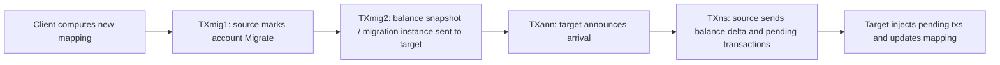
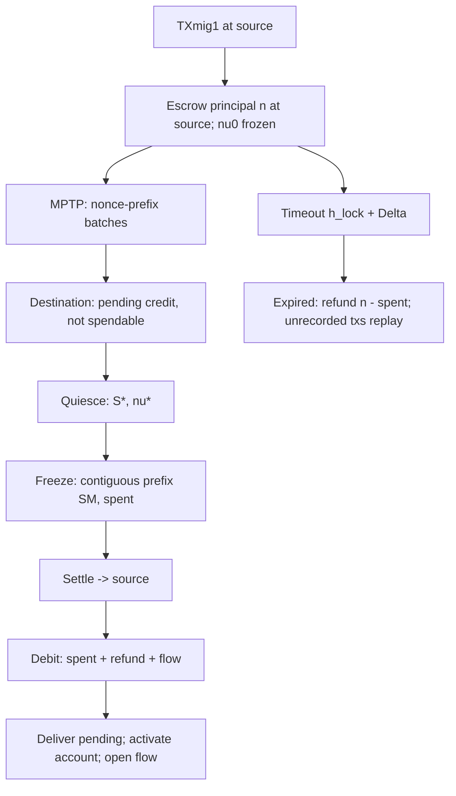

# AGENTS.md

Guidance for coding agents working on this repository. Read this before changing code or running experiments.

---

## 1. What this repository is

This is a **blockchain-sharding simulator** derived from an older **BlockEmulator** codebase. It is not a production blockchain. It simulates:

- multiple shards,
- account migration between shards,
- transaction locking/release around migration,
- cross-shard relay,
- PBFT-like message plumbing (mostly unused in the current runtime path),
- several migration policies controlled by a single `Schema` switch.

The code base is Go (`go 1.20` in `go.mod`), with a small C++ METIS helper under `METIS/`.

### Research lineage

1. **LB-CHAIN** — conservative baseline; migrating accounts are fully locked.
2. **FTL** — Fine-tuned Lock (INFOCOM'24); only payer transactions are blocked during migration.
3. **CARAVAN** — team extension; merges same-account payer transactions at the destination before packing.
4. **PREEMPT (bank version)** — team extension; a shard bank pays on behalf of a migrating account and the account repays after arrival.
5. **PREEMPT_ESCROW** — current implementation; replaces the bank with escrow, nonce-prefix authorization, pending credit, and settle/refund.

> `README.md` is older and partially stale. `plan_preempt_escrow.md` is the current design/status document for the newest protocol.

---

## 2. Aim

Study and compare how different **transaction lock / release / merge / timing** policies affect:

- migration latency,
- transaction queue length,
- throughput / committed transaction count,
- cross-shard relay pressure,
- safety constraints around a migrating account’s balance and nonce.

The central mechanism is: what happens to a migrating account’s **payer transactions** (sender side, debits balance) and **payee transactions** (recipient side, credits balance) between the moment migration starts and the moment it completes.

---

## 3. Current status

### 3.1 Schema matrix

`params.Config.Schema` selects one of:

| Schema | Constant | Lock behavior | Payer tx handling | Notes |
|---|---|---|---|---|
| `lb` | `SchemaLB` | Full lock | Held until migration completes | Baseline |
| `ftl` | `SchemaFTL` | Half lock | Held until migration completes, then injected into destination | INFOCOM’24 baseline |
| `caravan` | `SchemaCaravan` | Half lock | FTL + destination-side aggregation into `TXcaravan` | 1 slot per sender |
| `preempt` | `SchemaPreempt` | Half lock | Bank pays; loan/debt/settlement | Old bank version, keep for comparison |
| `preempt_escrow` | `SchemaPreemptEscrow` | Half lock | Escrow + nonce-prefix batch authorization + pending credit + settle/refund | New version |

Default `params.Config.Schema` is **`SchemaPreempt`** (old bank version). Experiment CSVs set `PREEMPT_ESCROW` explicitly.

### 3.2 `preempt_escrow` implementation status

**Implemented (P0–P4):**

- isolated schema and config,
- real-balance escrow lock,
- nonce side-book (`EscrowTx` wrapper; `Transaction` is unchanged),
- MPTP (migration payer transaction pool) with contiguous nonce-prefix batches,
- pending-credit ledger at destination,
- Quiesce / Freeze / Settle / Debit / Deliver,
- timeout expiry and refund,
- lost-batch archive/replay via `EscrowBatchArchive`,
- flow gate and post-cutover nonce ordering,
- terminal drain (`escrowStart` / `escrowBusy` / `escrowTerm`),
- compact experiment logs (`S*_escrow.csv`, `S*_escrow_queue.csv`),
- bounded nonce-gap repair (`EscrowGapRepairBlocks`, default 30 blocks).

**Instrumentation / handoff fixes (P1):**

- `quiesce` rows in `S*_escrow.csv` carry `trigger=delay|timeout` in `note`; the trigger is derived from `EscrowQuiesce.Status` (timeout path stamps `EscrowExpired`, delay path keeps `EscrowQuiescing`), so no wire/hash change.
- `S*_escrow_queue.csv`: `pending` now counts only undelivered (`!Delivered`) instances, and `pending_credits` was appended (recorded-but-not-delivered delegated txs, from `PendingRecord.PendingTxs`).
- `zip_res.sh` writes `QuiesceDelayBlocks`, `MigrationTimeoutBlocks`, `SettlementWaitBlocks`, `MaxEscrowBatchTxs`, `EscrowGapRepairBlocks`, `EscrowInitBalance` into `log/params.txt` when the schema is `preempt_escrow` (old schemas keep the old file).
- payer txs arriving at the destination during the Settle → Debit handoff window are no longer dropped by the `FetchTxs2Pack` own-shard filter; they are buffered in `EscrowGated` (`account.InLocalEscrowFlow`). Relay/payee direction during that window is **not** covered yet.
- txs still sitting in the source shard's normal queue when the account settles are swept into `Debit.Remaining` (`Tx_pool.TakeQueuedFor`) and replayed through gated at `S_own`, instead of being dropped at the next fetch.
- intake ledger: `log/client_inject.csv`, `log/S*_intake.csv`, `log/S*_queue_dump.csv` + `./audit_run.sh` (see §7.3 and §9.4).

**Not implemented (P5):**

- real transaction signatures (dataset has no private keys),
- Merkle proof verification,
- source-block-header sync,
- multi-validator forwarding / anti-withholding,
- reliable message ack/retry,
- crash recovery / durable migration state.

Do not claim complete security semantics for `preempt_escrow` until P5 exists.

### 3.3 Validation status

- `go build ./...` passes.
- `go test ./account/... ./core/... ./params/...` passes.
- `go test -vet=off ./...` passes.
- `go test ./...` without `-vet=off` is blocked by **pre-existing** vet warnings in old files (`fmt.Println` with redundant newline). Do not “fix” them unless the task is specifically cleanup.
- `preempt_escrow` has been smoke-tested with 2 shards / 1 node per shard / 8000 transactions:
  - lock/quiesce/settle counts match across shards,
  - settle and debit totals match,
  - MPTP/gated/normal queues drain to 0,
  - all shards report terminal,
  - no escrow/settlement residual warnings.
- `lb` and old `preempt` have been smoke-tested after the changes and still run.
- `./smoke_test.sh` (fast) and `./smoke_test.sh --e2e` pass. Latest e2e: 2 shards / 1 node / 8000 txs / `inject=200` / `mcb=2`, ~70 s, `lock=100 quiesce=100 settle=100 batch=48`, `pending_credits` peaks then returns to 0.

---

## 4. Quick start

### Build and unit tests

```bash
go build ./...
go test ./account/... ./core/... ./params/...
go test -vet=off ./...
```

### Run one experiment

```bash
./set_config.sh --schema preempt-escrow
SCHEMA=preempt_escrow NUM_SHARDS=2 NUM_NODES=1 TEST_FILE=20W.csv ./run.sh
```

`run.sh`:

1. kills leftover nodes,
2. cleans databases/logs,
3. rewrites `params/config.go`,
4. builds `block_exe`,
5. finds a free port base,
6. starts `S × N` nodes plus one client,
7. waits for `停止时间` in the client log,
8. kills nodes and packages results with `zip_res.sh` (set `NO_PACK=1` to skip packaging — used by `smoke_test.sh`).

### Smoke test

```bash
./smoke_test.sh                 # ~10 s, no side effects
./smoke_test.sh --e2e           # ~1-2 min, adds a real end-to-end run
```

`--e2e` backs up and restores `params/config.go`, refuses to run while another `block_exe` is alive (`SMOKE_FORCE=1` overrides), and uses `NO_PACK=1` so it never writes to `res/` or the caddy directory. See §9.2.

### Batch experiments

```bash
# Parse only
DRY_RUN=1 ./run_exp.sh exp.csv

# Run all rows
./run_exp.sh exp.csv

# Resume after the first experiment already completed
./run_exp.sh exp_resume.csv
```

`exp.csv` uses `PREEMPT_ESCROW` for the new protocol. `exp_resume.csv` contains rows 2–10 of the current experiment list.

### Cleanup

```bash
./kill_block_exe.sh
./clean.sh
```

`clean.sh` wipes `intermediate/`, `record/triedb/`, `log/`, and `process_logs/*.log`. It does **not** delete `res/`.

---

## 5. Architecture

### 5.1 Process model

- One **client/supervisor** process (`-c`) reads the dataset, assigns accounts to shards, injects transactions, triggers migration rounds, and stops the system.
- `num_shards × num_nodes` node processes are started.
- **Important:** the active proposal path is `Pbft.Propose → propose1 → commit1` in `pbft/pbftsingle.go`, i.e. **one active block producer per shard**. `N1…Nn` start, listen, and mostly idle. `handlePrePrepare` / `handlePrepare` / `handleCommit` exist but are not used by the current `Propose` loop.
- For local development use `NUM_NODES=1` unless you specifically need the old port/process layout. `num_nodes=16` creates 16 DBs/processes per shard and is expensive.

### 5.2 Shard/account mapping

- Initial mapping: last 5 hex characters of an address modulo shard count (`utils.Addr2Shard`, `account.Addr2Shard`).
- Migration decisions come from the client and a partitioning algorithm:
  - `CLPA` (default),
  - `PageRank`,
  - `LBF`,
  - `METIS` (invokes `METIS/partition`).
- `pbft/client.go` sends `cNewMap` with `new_addrs/new_addr2shard`; nodes enqueue `TXmig1` for accounts leaving.

### 5.3 Block cadence

- `Block_interval = 6` seconds.
- `MaxBlockSize = 2000` normal tx slots.
- `Max_Commit_Block` controls migration frequency (client decrements per committed block).
- `OnlyOnce` defaults to `100`; a batch run can therefore perform many migration rounds unless changed.

### 5.4 Migration message lifecycle (all schemas)



For `preempt_escrow` the ownership switch is deliberately delayed:

```text
TXmig1 -> escrow lock
TXmig2 -> destination Prepared (not active)
batches -> pending credit
Quiesce -> source stops authorization
Freeze -> destination fixes contiguous prefix
Settle/Debit -> escrow funds move; refund && flow
Activate -> destination becomes owner; flow gate opens
```

### 5.5 `preempt_escrow` flow



### 5.6 Datasets

- `20W.csv` is an Ethereum-like transaction CSV with 17 columns.
- The filter keeps ~**199,085** valid transfer rows.
- Used columns for `20W.csv`: `from` (3), `to` (4), `value` (8); contract creation/contract addresses/self-transfers are skipped.
- Genesis old schemas use `params.Init_balance = 10^60` (“infinite”).
- `preempt_escrow` uses `EscrowInitBalance` (default `10^26`). This is intentionally above the largest per-sender outflow in `20W.csv` to avoid ordinary negative balances. To actually exercise `total_cons <= n`, set it smaller and/or use a calibrated dataset.

---

## 6. Code organization

| Path | Responsibility |
|---|---|
| `main.go` | Entry point; calls `test.Test_shard()`. |
| `test/test_shard.go` | CLI flag parsing, dataset account scan, node/client startup. |
| `shard/shard.go` | Node bootstrap; initializes account maps and escrow state; injects txs if `ClientSendTX=false`. |
| `params/config.go` | `Schema`, flags, limits, bank/escrow balances, new escrow knobs. |
| `params/ports.go` | Free-port discovery (`FindFreePortBase`). |
| `account/account.go` | Address generation helpers. |
| `account/account_state.go` | `AccountState{Balance, Migrate, Location}`; global account→shard maps; migration lock maps. |
| `account/escrow_state.go` | **New**: escrow records, pending ledger, nonce side-book, flow gates. |
| `chain/blockchain.go` | Genesis, block generation, state trie updates, escrow execution, outboxes. |
| `core/transaction.go` | `Transaction`; no nonce field by design. |
| `core/block.go` | `Block`; optional `Escrow *EscrowBlockData`. |
| `core/txpool.go` | Normal queue, relay/lock/borrow/caravan pools, MPTP and escrow gated queues. |
| `core/escrow.go` | **New**: `EscrowTx`, `EscrowBatch`, quiesce/settle/debit/activate/delivery types. |
| `core/escrowpool.go` | **New**: quiesce/settle/debit pools. |
| `core/borrow.go` | Old bank-version `TXborrow`/`CreditEntry`. |
| `core/caravan.go` | Caravan `TXcaravan`. |
| `core/settle.go` | Old bank `TXsettle`. |
| `core/txmig1.go`, `txmig2.go`, `txann.go`, `txns.go`, `txrelay.go` | Migration message types. `TXmig2.MigID` is the new field. |
| `core/*pool.go` | Queues for migration messages. |
| `pbft/pbft.go` | Runtime, message dispatch, relay/migration senders. |
| `pbft/pbftsingle.go` | **Active** single-node commit path. |
| `pbft/escrow.go` | **New**: escrow message handlers, freeze/settle/debit, batch relay, terminal status. |
| `pbft/handleanns.go` | Old FTL announce/change-and-pending path. |
| `pbft/PBFTforMigrate.go` | Epoch/stop-mode migration path. |
| `pbft/client.go` | Client/supervisor, nonce assignment, escrow injection, drain. |
| `pbft/cmd.go` | Wire command constants (12-byte prefix) and message structs. |
| `algorithm/` | CLPA, PageRank, LBF, METIS partitioners. |
| `METIS/` | C++ helper used by METIS. |
| `storage/` | BoltDB block storage. |
| `trie/` | Local trie helpers; account state trie uses go-ethereum `trie`. |
| `utils/` | TCP framing, address→shard, misc helpers. |
| `run.sh`, `run_exp.sh`, `set_config.sh`, `schema_detect.sh`, `zip_res*.sh` | Experiment automation. |
| `smoke_test.sh` | Fast checks (`gofmt`/build/unit/`bash -n`); `--e2e` adds a short run and validates the logs. |
| `audit_run.sh` | Reconciles `client_inject.csv` against `transaction.csv`, delegated batches, intake drops and the queue dump. |
| `clean.sh`, `kill_block_exe.sh` | Cleanup. |
| `plan.md` | Old bank-mechanism design. |
| `plan_preempt_escrow.md` | Current preempt_escrow design, status, limitations. |

---

## 7. Key implementation details

### 7.1 Old schemas

- `lb`: `Lock_Acc_When_Migrating=true`; both payer and payee txs are locked.
- `ftl`: migrating account goes into `Outing_Acc_Before_Announce`; payer txs go to `Outing_Before_Announce_TX_Pools`; payee txs execute.
- `caravan`: FTL + `FromMigration` marking + `TXcaravan` aggregation + `TryRelayCaravans`.
- `preempt`: bank account at `account.BankAddrBytes(shardID)`; `TXborrow`, `Credit`, `Loan`, `TXns.Debt`, `TXsettle`.
- `IsPreempt()` matches **only** the old bank schema. Do not broaden it.

### 7.2 `preempt_escrow`

- **Lock**: in `chain/blockchain.go → getUpdatedTreeOfState`, the `TXmig1` loop moves the account’s actual balance into a deterministic escrow address (`account.EscrowAddr(migID)`) and creates an `EscrowRecord`.
- **Nonce**: client assigns per-sender nonce in dataset order. `EscrowTx{Tx, Nonce}` carries it. A shard-local side-book `account.NonceByTxID` maps `tx.Id → nonce`. `Transaction` is intentionally unchanged.
- **MPTP**: `Tx_pool.MPTP`; `BuildEscrowBatches` sorts by nonce and only takes the contiguous prefix while `total_cons + Φ <= credit`. It never skips a gap or an over-limit tx.
- **Batch archive**: `BlockChain.EscrowBatchArchive` retains authorized batches until settlement, so unrecorded batches can be replayed with original nonces.
- **Destination**: `PendingRecord` with pending map, materialized batch hashes, `NextSeq`, `NuDst`, `SStar`, `SM`, `Spent`, `Delivered`.
- **Freeze**: `FreezePending` freezes at the contiguous prefix when `recorded >= SStar` or `SettlementWaitBlocks` elapses.
- **Settle/Debit**: source debits escrow by `spent + refund`; destination receives `EscrowDebit`, credits settlement and (if `Settled`) the migrated account’s refund/flow; then delivers pending.
- **Ownership activation**: after Debit. `EscrowActivate` updates `Account2Shard` on all shards and the client. The destination sets `FlowActive` and `LastNonce = max(Nu0, NuDst)`.
- **Flow gate**: `FlowBlocked` is set when a `PendingRecord` is prepared and cleared at Debit. `FetchTxs2Pack` queues blocked/active flow txs in `EscrowGated`, drains contiguous nonces.
- **Terminal**: shard sends `escrowBusy` or `escrowTerm` per epoch; client stops only when all shards report terminal for the current epoch, injection is done, and queues are empty.
- **Gap repair**: if a gated nonce gap does not progress for `EscrowGapRepairBlocks` (default 30), it logs `[escrow][gap-repair]` and skips the missing nonce. Set to 0 for strict nonce semantics. This is a stopgap for missing ack/retry.
- **Handoff window (Settle → Debit)**: the source sets `Account2Shard[A] = dst` and deletes `AccountInOwnShard[A]` when Settle commits; the client re-routes on `EscrowActivate`; the destination only sets `AccountInOwnShard[A]` at Debit commit. `FetchTxs2Pack`'s own-shard filter runs *before* the escrow branches, so txs from A arriving at the destination in that window used to be dropped silently. They are now admitted via `account.InLocalEscrowFlow(from)` and land in `EscrowGated`, then drain after Debit. This only covers the **sender** side; relay/payee delivery in the same window is still dropped.

### 7.3 Logs and metrics

For `preempt_escrow`, `pbft.NewLog` creates:

- `log/S*_escrow.csv`
  - columns: `timestamp,height,event,mig_id,account,value,nu,status,note`
  - events: `lock`, `prepare`, `batch`, `quiesce`, `settle`, `debit`
  - `quiesce` notes look like `S*=N trigger=delay|timeout`.
- `log/S*_escrow_queue.csv`
  - columns: `height,mptp,gated,pending,terminal,pending_credits`
  - `pending` = undelivered (`!Delivered`) instances; `pending_credits` = recorded-but-not-delivered delegated txs in those instances.
  - `terminal` is `AllEscrowTerminal()` only; the client’s stop condition also requires `mptp == gated == normal == 0`.

Existing logs (`S*_block.csv`, `S*_queueLen.csv`, `S*_transaction.csv`, etc.) remain for all schemas. Old `preempt` still writes `S*_bank.csv`.

Intake reconciliation (all schemas, purely additive):

- `log/client_inject.csv` — `timestamp,shard,count,min_id,max_id`, one row per injection message (what the client handed to the transport).
- `log/S*_intake.csv` — cumulative per shard: `received, forwarded_out, dropped_not_own, dropped_dup, dropped_no_nonce, gated_in, mptp_in, gap_repair, dropped_relay`. `dropped_relay` = relay txs dropped because the recipient is not in this shard.
- `log/S*_queue_dump.csv` — `pool,txid,sender,nonce`, written once when the client sends `stop` (what never made it out of the queues).
- `./audit_run.sh [log|res/xxx.zip]` checks `injected = committed + delegated + dropped + queued + unexplained` and prints the escrow counters.

### 7.4 Important invariants

- `total_cons <= credit`
- `spent <= total_cons`
- `refund + spent == n`
- escrow residual 0 after Debit
- settlement residual 0 after Deliver
- no duplicate materialized batch
- nonce prefix strictly contiguous (unless gap repair is triggered)
- no negative balances (currently relies on calibrated `EscrowInitBalance`; full ordinary-tx balance queueing is not implemented)

---

## 8. Hints for modifying the code

### 8.1 Isolation rules (most important)

1. **Do not change old schema behavior** unless the task explicitly says so.
2. Put every new behavior behind `params.Config.IsPreemptEscrow()`.
3. Do **not** make `IsPreempt()` match `SchemaPreemptEscrow`; the old bank path must not run for the new schema.
4. Prefer new files (`core/escrow.go`, `account/escrow_state.go`, `pbft/escrow.go`) over editing old functions.
5. If a shared function must change, add an early guarded branch and leave the old branch intact.
6. Keep default `Schema` as `SchemaPreempt` unless the user asks to change it.

### 8.2 If adding a new schema

- Add the constant and `Is...()` predicate in `params/config.go`.
- Add `Normalize()` mapping (full lock vs half lock).
- Add `set_config.sh` alias and `schema_detect.sh` detection (watch ordering: old `preempt` is a prefix of `preempt_escrow`).
- Add a `run_exp.sh` row/column mapping if needed.
- Add a new log file; do not add columns to old CSVs.

### 8.3 If adding a block/message field

- `Block` currently has optional `Escrow *EscrowBlockData`; old schemas leave it nil. Keep it that way.
- New message structs should be additive and encoded with gob (or JSON consistently); remember `prefixCMDLength = 12`, so command names must be **≤ 12 bytes**.
- If you add fields to `Transaction` or `AccountState`, be aware that gob type descriptors and hashes/state roots can change for old schemas. Prefer `EscrowTx` wrappers/side tables for new protocol metadata.
- If you change block encoding, old DBs still decode missing fields as zero, but clean DBs between runs. `clean.sh` should be part of experiment hygiene.

### 8.4 Determinism

- Sort map-derived entries before building batches/proofs/blocks. The old `FetchBorrows2Pack`/`FetchCaravans2Pack` iterate maps without sorting.
- For nonce/batch logic, never rely on Go map iteration order.
- Use `migID`, nonce ranges, and batch hashes as stable keys.
- Avoid wall-clock time in protocol decisions; use block heights (timeouts) and deterministic ordering.

### 8.5 Message reliability

The simulator’s `utils.TcpDial` retries once and then drops a message. There is no ack/retry. Consequences:

- a lost `EscrowTxsFromClient` can create a permanent nonce gap;
- a lost settle/quiesce can leave migration state incomplete;
- `EscrowGapRepairBlocks` only handles the gated nonce-gap symptom.

If you implement P5, add:

- `mig_id + attempt/epoch` fencing,
- ack/retry,
- idempotent settle/debit/deliver,
- durable migration state.

### 8.6 Known pitfalls

- **`test/test_shard.go` dataset filter uses the package-level `path` variable from `test/test_random.go`** (always `0to999999_BlockTransaction.csv`), not `config.Path`. This makes the 20W column layout branch always active. `pbft/client.go` uses the real path. For smoke tests with a custom file, keep the filename literally `20W.csv` or use the full `20W.csv`.
- `num_nodes=16` starts 16 processes per shard but only N0 produces blocks. Use `NUM_NODES=1` for development.
- `run.sh` defaults to `SCHEMA=lb`; `run_exp.sh` sets `SCHEMA` from the CSV. `params.Config` defaults to `SchemaPreempt`.
- `set_config.sh` rewrites `params/config.go` in place. If an experiment is running, changing config concurrently can affect `zip_res.sh` naming; don’t edit config while a run is active.
- `zip_res.sh` copies results to `/disc/home/dy/caddy/site`, an environment-specific path. It may not exist on another machine.
- Running 16 shards × 16 nodes creates a lot of LevelDB/trie files under `intermediate/` and `record/`; `clean.sh` is mandatory between large runs.
- The old block/PBFT path is not the active runtime path. Do not use its presence to infer consensus behavior.
- Relay txs are routed by `account.Addr2Shard(recipient)` (the **static initial** shard) in `handleRelay`, not by `Account2Shard`. A payment to an account that has already migrated is therefore sent to the wrong shard and dropped by the `dropped_relay` branch in `FetchTxs2Pack`. Fixing this changes all schemas, so it needs an explicit decision.
- `pending_credits` reaches 0 at Debit (settlement), not when the recipient actually receives the funds: cross-shard deliveries are synthetic relay txs and there is no ack. Treat it as “recorded but not yet settled”.

---

## 9. Testing

### 9.1 Unit tests (fast)

```bash
go build ./...
go test ./account/... ./core/... ./params/...
go test -vet=off ./...
```

New tests relevant to the escrow protocol:

- `core/escrow_test.go`
  - contiguous nonce prefix,
  - over-credit stop,
  - no skipping a gap,
  - batch/delivery codecs,
  - gap-repair behavior.
- `account/escrow_state_test.go`
  - escrow/settlement address derivation,
  - nonce side-book monotonicity,
  - pending sequence/freeze,
  - terminal and flow-gate state.
- `params/config_test.go`
  - schema predicates and `Normalize`.

### 9.2 Smoke test (scripted)

```bash
./smoke_test.sh          # gofmt + go build + unit tests + bash -n (~10 s)
./smoke_test.sh --e2e    # adds a real run and validates the logs (~1-2 min)
```

`--e2e` defaults: 2 shards / 1 node / 8000 txs / `inject=200` / `mcb=2`, and checks:

- no `panic:` in `process_logs/*.log`,
- the client printed `停止时间`,
- every shard produced `block.csv`,
- `mptp / gated / pending / pending_credits` all reach 0 and `terminal=true`,
- no `[escrow][invariant]` warnings,
- `lock -> quiesce -> settle` actually ran, and every `quiesce` row has `trigger=delay|timeout`.

`inject=200` is deliberate: injection must span the lock window for `batch` events to appear. At `inject=1000` the run usually only exercises `lock/quiesce/settle`.

Manual equivalent:

```bash
SCHEMA=preempt_escrow NUM_SHARDS=2 NUM_NODES=1 TEST_FILE=20W.csv ./run.sh
```

A subset can live in a subdirectory (`TEST_FILE=smoke/20W.csv`): the client picks the column layout by `filepath.Base(path)`, but the file name must still be `20W.csv`.

### 9.3 Regression test for old schemas

After any shared-code change, run a short `lb` and/or old `preempt` smoke:

```bash
./set_config.sh --schema lb
SCHEMA=lb NUM_SHARDS=2 NUM_NODES=1 TEST_FILE=20W.csv ./run.sh
```

Check:

- no panic,
- old `_block.csv` / `_queueLen.csv` still produced,
- old `_bank.csv` still produced only for old `preempt`,
- no `_escrow.csv` for old schemas.

### 9.4 Intake audit

```bash
./audit_run.sh                 # 默认 ./log
./audit_run.sh log             # 指定目录
./audit_run.sh res/xxx.zip     # 直接核归档
```

It enforces `injected = committed + delegated + dropped + queued + unexplained` and exits non-zero if the remainder is not 0. Use it on every run you intend to publish.

Known Gate-1 baseline (ns4 / is1000 / mcb25 / nn16, full `20W.csv`):

| schema | injected | committed | delegated | dropped | unexplained |
|---|---|---|---|---|---|
| `ftl` (control) | 199,085 | 198,092 | 0 | 553 | 440 |
| `preempt_escrow` (after the handoff fixes) | 199,085 | 170,649 | 19,979 | 5,862 relay | 2,595 |

Progression on the escrow side (same config each time):

| build | committed | dropped_not_own | dropped_relay | unexplained |
|---|---|---|---|---|
| before the handoff fixes | 168,188 | 6,923 | 0 | 3,410 |
| + `TakeQueuedFor` sweep | 170,734 | 5,246 | 0 | 2,576 |
| + intake routing (`InLocalEscrowFlow` in `handleEscrowTxsFromClient`) | 170,649 | **0** | 5,862 | 2,595 |

The sweep removed the sender-side drops; the intake-routing fix stopped txs bouncing between source and destination during the settle→debit window (forwarded_out dropped from 29,860 to 82). What remains is relay delivery: `handleRelay` routes by `Addr2Shard` (static), so payments to migrated recipients land on the wrong shard and are dropped (`dropped_relay`), and unacked relay/delivery messages account for the rest. Both need a decision because the routing change also affects the old schemas.

### 9.5 What not to run casually

- Do not run the full 16-shard × 16-node matrix just to test compilation.
- Do not run `go test ./...` expecting a clean pass; pre-existing vet warnings in old files fail it. Use `-vet=off` or targeted packages.
- Do not start a full experiment in the foreground outside `tmux`; runs can take many minutes/hours.

---

## 10. Experiment workflow

1. Edit `exp.csv` or create a resume CSV. Header must be the **first line**.
2. Recognized columns:
   - `scheme` / `schema`
   - `num_shards` / `ns` / `shards`
   - `Inject_speed` / `is` / `inject`
   - `num_nodes` / `nn` / `nodes`
   - `Max_Commit_Block` / `mcb`
   - `MaxBlockSize` / `mb`
3. `Lock_Acc_When_Migrating` is **not parsed** by `run_exp.sh`. `preempt_escrow` forces it false via `Normalize()`. Add parser support if it needs to be a real experiment variable.
4. `PREEMPT` alone maps to old `SchemaPreempt`; use `PREEMPT_ESCROW` for the new protocol.
5. Preview with `DRY_RUN=1 ./run_exp.sh exp.csv`.
6. Run inside `tmux`:
   ```bash
   tmux new -s preempt-exp
   ./run_exp.sh exp.csv
   ```
7. Results go to `res/res_<schema>_ns...zip`.
8. If a run hangs, inspect:
   - `process_logs/client.log`,
   - `process_logs/S*_N0.log`,
   - `log/S*_escrow_queue.csv` (gated/mptp),
   - `log/S*_escrow.csv` (lock/settle/debit),
   - `process_logs/*.log` for panics.
9. Stop stuck runs with Ctrl-C in tmux. `run_exp.sh` treats INT/TERM as **abort the whole batch** (kills nodes, exits 130) — it no longer falls through to the next row. To continue from a later row, start a resume CSV instead.

---

## 11. Troubleshooting

| Symptom | Check |
|---|---|
| Client never prints `停止时间` | `log/S*_escrow_queue.csv`: `gated/mptp` nonzero? All shards terminal? |
| `停止时间` never appears and `lock` rows are also absent | The partitioner changed nothing this round (empty migration round): shards never create escrow state and never report terminal. `migration_count` only increments when `len(new_addrs) != 0`, so this should exit; check `process_logs/client.log` for `次数` and repeated `所有迁移都完成啦`. |
| Dataset in a subdirectory parses the wrong columns | The layout is chosen by `filepath.Base(path)`; the file name must still be `20W.csv` (or another known name), but the directory is free. |
| `pending` sits at the instance count forever | That was the old bug: it counted `AllPendingRecords()`. Current builds count only undelivered instances and add `pending_credits`. |
| `gated` constant for many blocks | Nonce gap; look for `[escrow][gap-repair]` after `EscrowGapRepairBlocks`; check for lost injection. |
| `[escrow][invariant] escrow residual` | Settlement math / duplicate batch / incorrect `SM`/`NuDst`. |
| `[escrow][invariant] settlement residual` | Pending sum vs `spent`; check batch outputs and delivery. |
| `panic: slice bounds out of range [-5:]` | An empty `Transaction.Sender`; synthetic relay txs must set a 20-byte sender. |
| `gob: bad data` | Sender/receiver codec mismatch (gob vs JSON) for a command. Check both sides of a message. |
| Ports occupied | `./kill_block_exe.sh`; `run.sh` auto-selects a free range, or set `PORT_BASE`. |
| Old schema behavior changed | Search for unguarded `IsPreemptEscrow` branches or changes in old pool branches. |
| Payer txs vanish in the Settle → Debit window | Check `account.InLocalEscrowFlow` is still consulted by the `FetchTxs2Pack` own-shard filter (`core/txpool.go`). |
| `S*_intake.csv` shows `dropped_not_own` for a settling account | Txs were still in the source queue at settle; `Tx_pool.TakeQueuedFor` should sweep them into `Debit.Remaining`. |
| `dropped_relay` is large | Relays are routed by `account.Addr2Shard(recipient)` (static initial shard), so payments to already-migrated accounts are sent to the wrong shard and dropped. Needs a routing decision (see §8.6). |
| `audit_run.sh` reports unexplained txs | `utils.TcpDial` drops a message after one retry; check for holes in the injection/batch/settle channels. Run with `log/client_inject.csv` vs `S*_intake.csv` `received` to see whether the loss is client-side or shard-side. |

---

## 12. Do not

- Do not commit or push unless the user explicitly asks.
- Do not replace old schemas with `preempt_escrow`; add/keep them for comparison.
- Do not remove the old bank-version `preempt` path.
- Do not add a nonce field to `core.Transaction` without considering the serialization/hash impact on all schemas.
- Do not claim signature/proof/multi-validator security for the current prototype.
- Do not rely on `OnlyOnce=100` for a short smoke; override it if you need a quick run.
- Do not overwrite user experiment results in `res/` without asking.

---

## 13. Useful commands

```bash
# Build
go build ./...

# Focused tests
go test ./account/... ./core/... ./params/...
go test -vet=off ./...

# Smoke test（改完先跑这个）
./smoke_test.sh
./smoke_test.sh --e2e

# Configure a schema
./set_config.sh --schema lb
./set_config.sh --schema ftl
./set_config.sh --schema caravan
./set_config.sh --schema preempt
./set_config.sh --schema preempt-escrow

# Single run
SCHEMA=preempt_escrow NUM_SHARDS=2 NUM_NODES=1 TEST_FILE=20W.csv ./run.sh

# Batch run
DRY_RUN=1 ./run_exp.sh exp.csv
./run_exp.sh exp.csv

# Cleanup
./kill_block_exe.sh
./clean.sh

# Inspect
tail -f process_logs/client.log
tail -f process_logs/S0_N0.log
tail -f log/S0_escrow_queue.csv
```

---

## 14. References in-repo

- `plan_preempt_escrow.md` — current protocol design, implementation status, deviations, P5 gaps.
- `plan.md` — older bank-mechanism plan; still relevant to old `preempt`.
- `README.md` — historical branch description; partially stale.
- `exp.csv`, `exp_resume.csv` — current experiment lists.
- `res/` — packaged experiment results (zip archives).
- `res_all_*.zip` — bundles of result archives.
